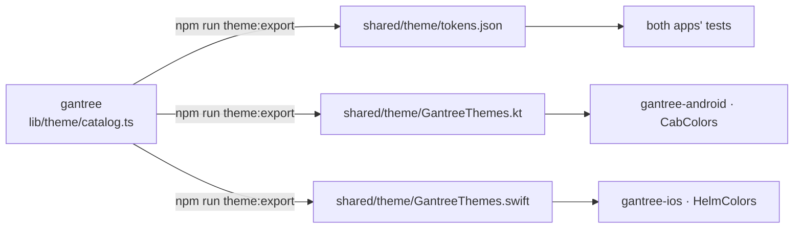

# Theming

One catalog, three outputs, zero hand-copied hexes.



## Source

`lib/theme/catalog.ts` in gantree. Fifteen ids — `boom` (default),
`paper`, `ink`, and six mood pairs `marquee`/`lemonade`, `neon`/`fizz`,
`rain`/`mist`, `fuse`/`grit`, `siren`/`flare`, `static`/`flicker`. Each
theme is `{ id, label, feel, mood, tokens }`; `tokens` is the full CSS
custom-property set the PWA paints, plus `scheme: "dark" | "light"`.

## Generated files

From the gantree checkout:

```sh
npm run theme:export -- ../gantree2-apps/shared/theme --kotlin-package com.gantree.theme
```

| File | Shape | Consumer |
| --- | --- | --- |
| `tokens.json` | `{ default, themes: [{ id, label, feel, mood, tokens: { canvas: "#0e1316", … } }] }` | tests; any tool |
| `GantreeThemes.kt` | `data class GantreeTheme(... val canvas: Color ...)`; `object GantreeThemes { DEFAULT, all, ids, of(id) }`; colors as `Color(0xFFRRGGBB)` | gantree-android |
| `GantreeThemes.swift` | `struct GantreeTheme` with `UInt32` `0xRRGGBB`; `enum GantreeThemes { defaultId, all, ids, of(_:) }` | gantree-ios |

`of(id)` returns the default for unknown or nil input, same as the
Worker's `parseTheme`. The apps delete their own fallback logic.

The header line says "Do not edit." CI's `theme-drift` job re-runs the
export and fails on any diff, so an edit here is caught, and a hex
moved in gantree without re-exporting is caught too.

## Mapping in the apps

gantree-android's `CabColors` and gantree-ios's `HelmColors` have the same seventeen
fields (`canvas panel track line edge fg body muted dim accent mark
accentLine accentSoft danger ok you kit` + `scheme`). The generated
types carry every catalog token, which is a superset. Each app keeps
its small struct and a one-line-per-field mapper from `GantreeTheme`;
nothing else changes. When a new token is added to the catalog it
appears in the generated file and is simply unused until a screen
wants it.

## Rules

- A color change is a change to `catalog.ts`, a re-export, and a
  commit in each repo. Never to a `.kt` or `.swift`.
- New theme = new catalog entry. It shows up on both phones on the next
  export; no app code.
- Contrast is gated in gantree (`lib/theme/contrast.ts`, Boom
  exemptions). The apps trust the catalog and do not re-check.
- Font ids (`sm` / `md` / `lg`) and motion rules are app-side for now;
  if they drift, add them to the catalog and the exporter rather than
  to this doc.
