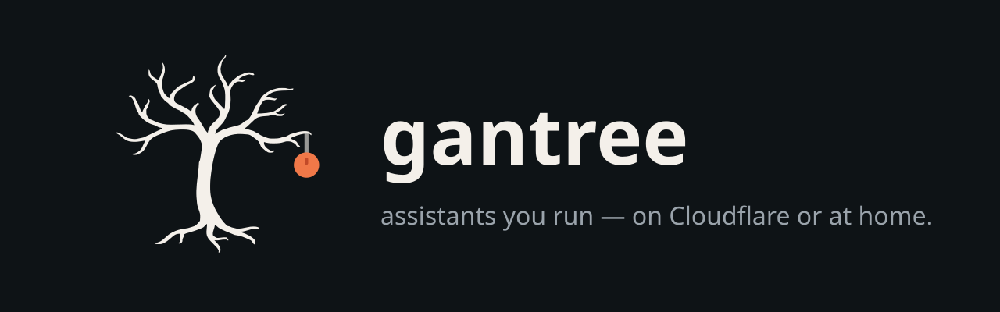
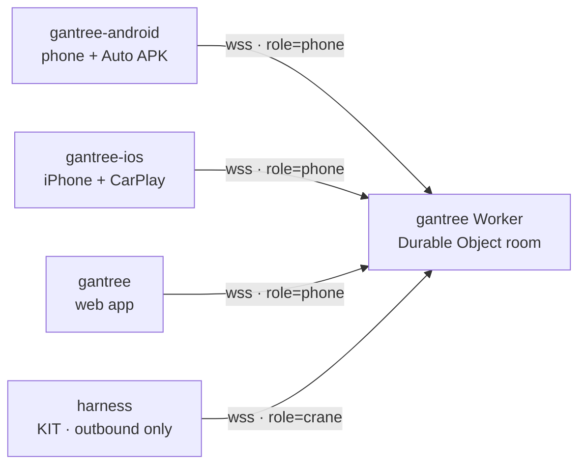
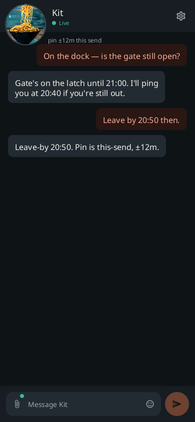
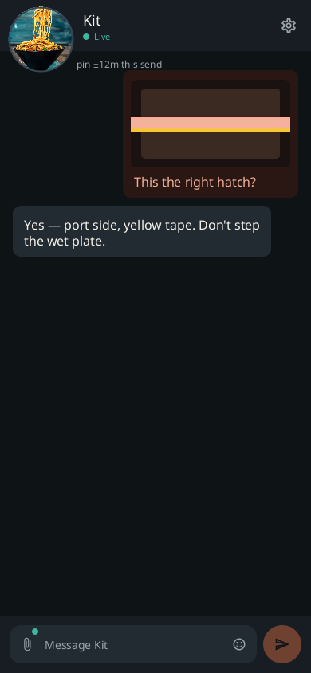
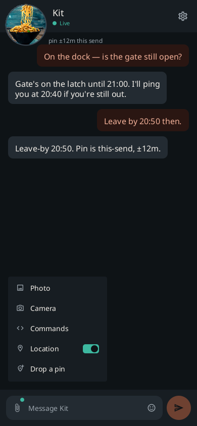
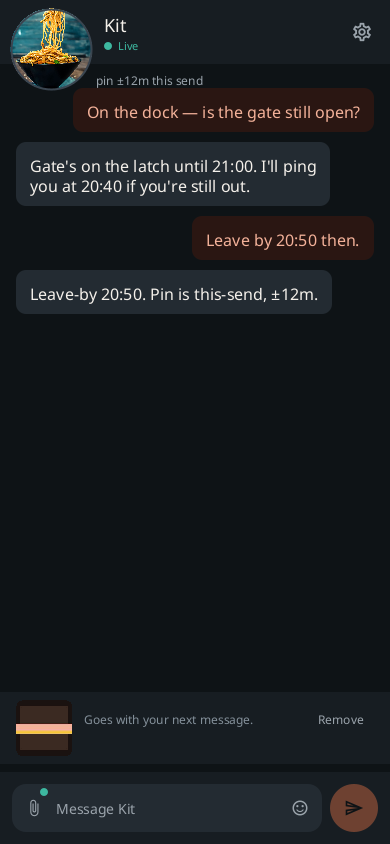
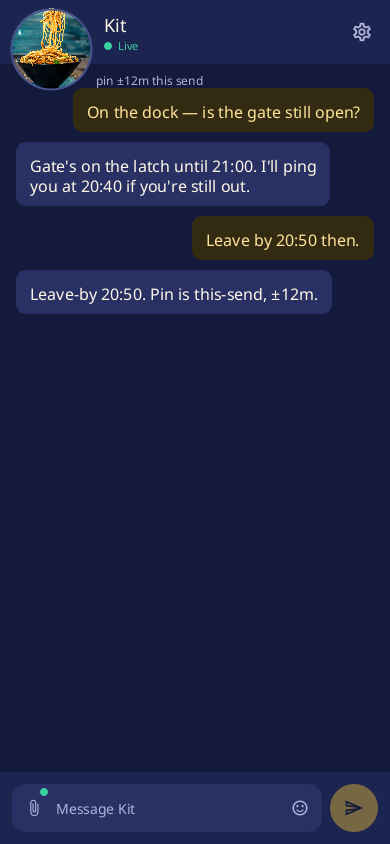
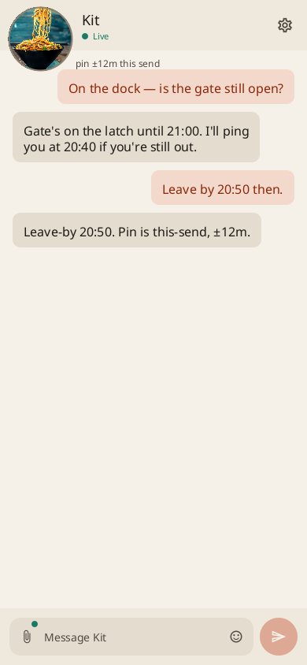
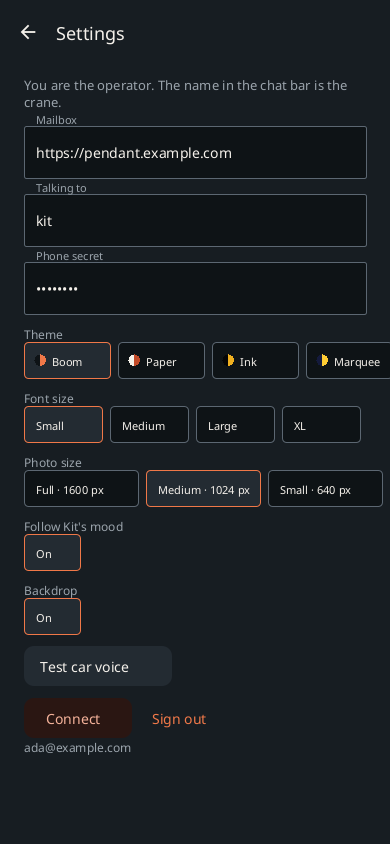
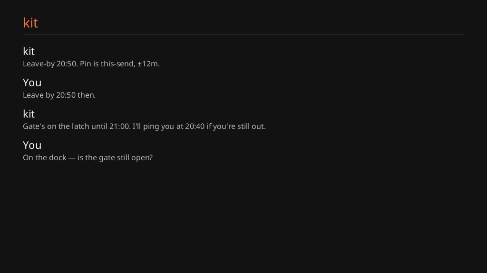

# gantree-android

<p align="center">
  
</p>

<p align="center">
  <a href="https://github.com/shotah/gantree2-apps/actions/workflows/ci.yml"></a>
  <a href="https://github.com/shotah/gantree2-apps/actions/workflows/ci.yml"></a>
  <a href="https://github.com/shotah/gantree2-apps/releases"></a>
  <a href="../LICENSE"></a>
</p>

[gantree2](https://github.com/shotah/gantree2) is the web app, the
Worker (Durable Object mailbox), and the agent harness. **This APK is
the phone** — pocket thread, and Kit as a message card over maps.
Same room. Same agent. The harness opens **zero** inbound ports.
[gantree-ios](../gantree-ios/) is the iPhone sibling in this repo —
same mailbox, CarPlay message cards.

```text
gantree-android APK  ─┐
gantree-ios IPA      ─┤
gantree web app      ─┼─►  gantree Worker (Durable Object)  ◄──  harness (outbound)
                     │
The harness uses CHANNEL=chat. It never sits in the turn.
```



Android Auto reads Kit aloud and stuffs spoken replies into
`RemoteInput`. gantree turns that string into an `inbound` frame. It does
not wrap the Vinext PWA. It does not run React Native.

Paperclip is the rest of the mouth: photo or camera (caption + JPEG
travel together), slash commands, GPS on send, drop a pin. Kit can
pick the room's mood; you can unfollow and keep yours. Boom is the
default. Paper is the neutral light, Marquee is one mood — Settings
groups Plain and Moods.

<p align="center">
  
  &nbsp;
  
  &nbsp;
  
  &nbsp;
  
</p>

<p align="center">
  
  &nbsp;
  
  &nbsp;
  
  &nbsp;
  
</p>

Every screen: [docs/screens.md](docs/screens.md). `make shot` reshoots.
Phone + Auto install: [docs/sideload_to_android.md](docs/sideload_to_android.md).
Make the car talk: [docs/android_auto_setup.md](docs/android_auto_setup.md).
Open work: [docs/todo.md](docs/todo.md). Mailbox handoff:
[docs/chat_handoff.md](docs/chat_handoff.md). FCM (public-scale,
not this beta): [docs/fcm_design_and_todo.md](docs/fcm_design_and_todo.md).

| Repo | Job |
| --- | --- |
| **gantree-android** | This APK. Pocket thread + Auto message cards. |
| [gantree-ios](../gantree-ios/) | iOS app. Pocket thread + CarPlay message cards. |
| [gantree2](https://github.com/shotah/gantree2) | Web app, Worker, and the agent harness (`harness/`). One room per agent slug. The harness dials **out**. |


## This is not

- A Chrome Install / TWA / PWA in the dash. Auto will not project that.
- A Play Store listing (sideload or Play **internal** testing).
- A second mailbox. Forking the Worker is how you get two rooms.

## Talks to gantree

| Call | What |
| --- | --- |
| `GET /api/auth/config` | spike vs Google |
| `GET /api/auth/nonce` | server-sealed nonce (10 min, not stored) |
| `POST /api/auth/token` | `{ id_token, nonce }` → `{ token, sub, email, exp }` |
| `GET /api/auth/me` | `Authorization: Bearer <jwe>` → `{ sub, email, role, agents }` |
| `GET /ws/<slug>?role=phone` | WebSocket. Header is the JWE (Google) or the spike secret |

403 on `POST /api/auth/token`: Google verified you, but you are not on the gantree list. No session — copy your id and send it to your gantree admin.

Spike walk: emulator → `http://10.0.2.2:3000`, paste the mailbox
secret. Production: copy gantree’s **Web** client id into
`CAB_GOOGLE_WEB_CLIENT_ID`, and create a **new Android** OAuth client
(package `com.gantree.cab` + SHA-1, no redirect URI). gantree POSTs the
token to `/api/auth/token` — Google is not given a gantree callback.

## Hello

Android Studio works. So does make, same shape as
[gantree2](https://github.com/shotah/gantree2):

```bash
make test            # script tests + JVM unit tests
make lint            # Android lint
make coverage        # JaCoCo + 70% bar (mailbox + mouth)
make check-app       # lint + test + coverage (one Gradle invocation)
make install-hooks   # pre-commit: tests; pre-push: lint + coverage
make watch           # continuous mailbox JVM tests
make shot            # phone + Auto PNGs → assets/docs
make build           # debug APK
make apk             # sideload APK (GitHub Release uses this)
```

Needs JDK 21 and an Android SDK (`local.properties` `sdk.dir`, or
`ANDROID_HOME`). Script tests (`make test-scripts`) do not. This folder
lives in the `gantree2-apps` repo next to `gantree-ios/`; the shared theme
and brand come from `../shared/`. Walk: [docs/setup.md](docs/setup.md).

```bash
# on the gantree checkout
npm run dev          # 127.0.0.1:3000 — emulator reaches it as 10.0.2.2
```

In gantree: origin `http://10.0.2.2:3000`, slug `kit`, spike secret from
`.dev.vars`. Type. Reply in the agent tab. Auto: Desktop Head Unit
for the `ConversationItem` screen; a real head unit only gets the
message cards (Android Auto → Developer settings → Unknown sources).

Google Sign-In needs **two** OAuth clients in gantree’s GCP project:
the existing **Web** client id in `CAB_GOOGLE_WEB_CLIENT_ID` (copied
from gantree — that is the token `aud`), and a **new Android** client
(`com.gantree.cab` + this APK’s SHA-1 from the GitHub Release notes).
The Android client has **no** redirect URI. gantree never opens Chrome;
it POSTs the ID token to the mailbox `/api/auth/token`. Walk:
[docs/setup.md](docs/setup.md#google-production-worker). GitHub
Release bakes the Web id from Actions secrets. The public tree only
has fake example hosts.

## Auto

Notification messaging (`MessagingStyle` + reply + mark-as-read) is
the car. Kit's reply is a message card over maps or music; Auto reads
it and takes a spoken reply. That is the whole sideload story — Auto's
**Unknown sources** switch admits notifications from a non-Play APK,
and nothing else.

The `ConversationItem` screen (`CabCarAppService`, Car API 7) is real
but only reachable on the Desktop Head Unit or a Play internal-testing
install: Google's unknown-sources toggle "doesn't apply to apps built
using the Android for Cars App Library", and templated messaging is
Play internal/closed testing only. Do not expect a gantree tile in a car.
Settings → **Test car voice** posts a check card through the same
path so you can hear it in the driveway.

Foreground socket while gantree is open, you Connect, or you send — not
on boot. Auto cannot start gantree, so **open the app and send a line
before you plug in**, then lock the phone. FCM lock-screen (process
dead, WhatsApp-class) is not demo / POC / family-beta; it is if gantree
becomes a public service. Design:
[docs/fcm_design_and_todo.md](docs/fcm_design_and_todo.md).
