#  gantree-ios

<p align="center">
  
</p>

<p align="center">
  <a href="https://github.com/shotah/gantree2-apps/actions/workflows/ci.yml"></a>
  <a href="https://github.com/shotah/gantree2-apps/actions/workflows/ci.yml"></a>
  <a href="../LICENSE"></a>
</p>

gantree on iPhone: the pocket thread, and Kit as a communication
notification over CarPlay maps. Same room as the gantree web app and
gantree-android. The harness dials **out**. The phone opens **zero**
inbound ports.

```text
gantree-ios IPA     ─┐
gantree-android APK ─┼─►  gantree Worker (Durable Object)  ◄──  the harness (outbound)
gantree web         ─┘
The harness uses CHANNEL=chat. It dials out.
```

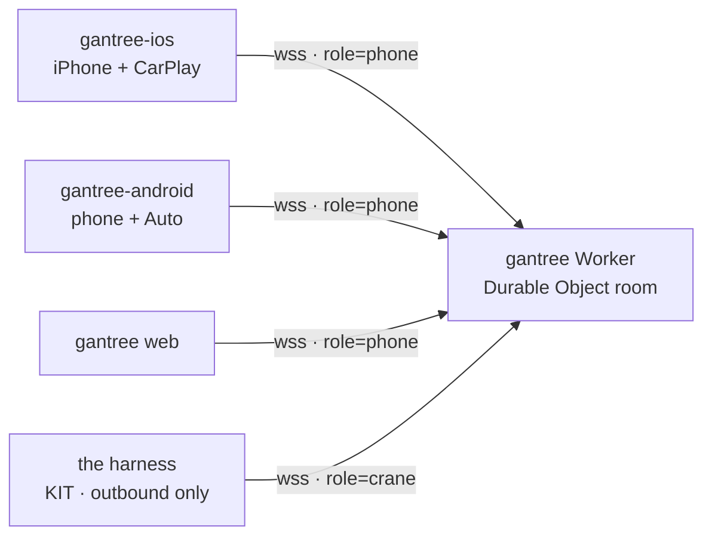

`role=crane` is the harness socket role (`agent` is an alias).

gantree-ios is Swift. It does not wrap the web app. It does not run
React Native. It does not fork the Worker.

CarPlay reads Kit aloud from a **communication notification**. Spoken
reply becomes `inbound` with `surface: carplay`. The phone thread
uses `surface: ios`. The Worker accepts `browser`, `android`,
`android_auto`, `ios`, and `carplay`.

Paperclip is the rest of the mouth: photo or camera (caption + JPEG
travel together), slash commands, GPS on send, drop a pin. Kit can
pick the room's mood; you can unfollow and keep yours. Boom is the
default.

## Screens

<p align="center">
  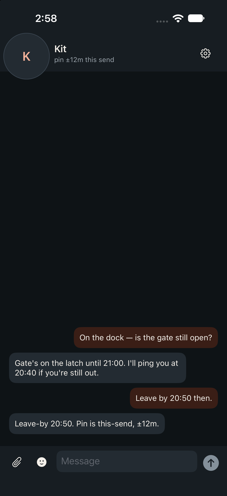
  
  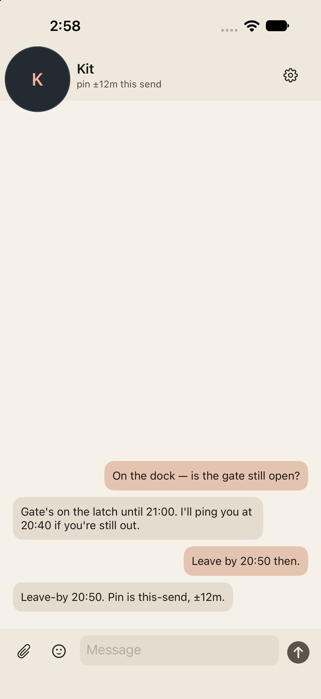
  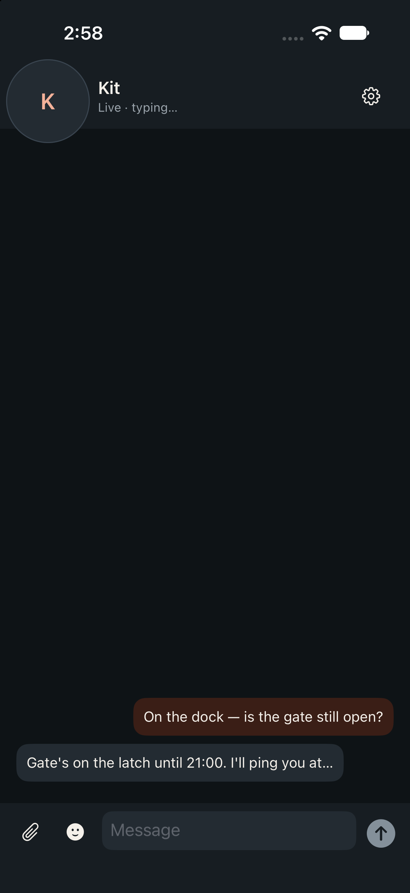
</p>
<p align="center">
  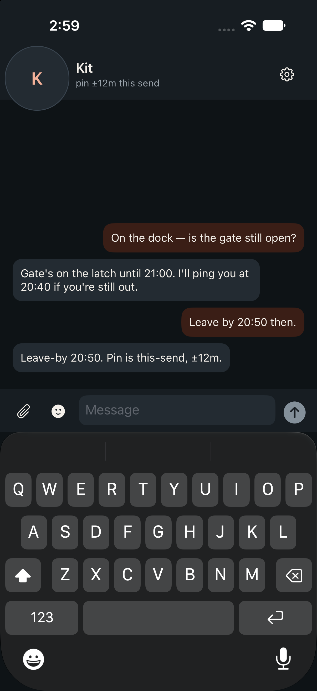
  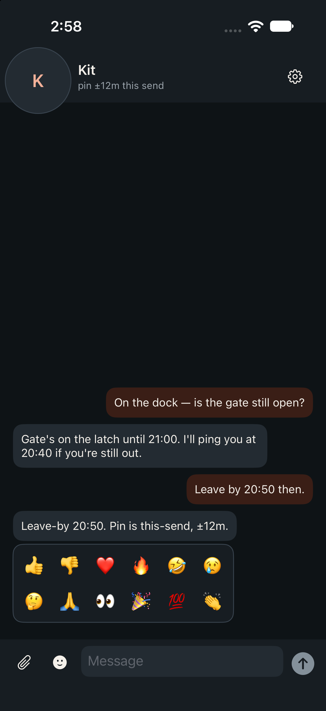
  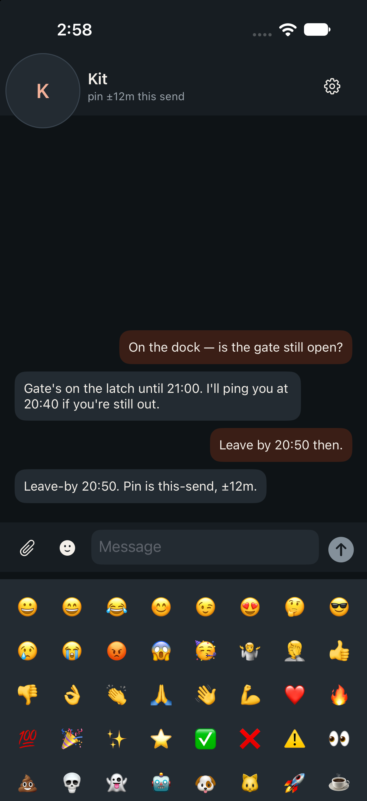
  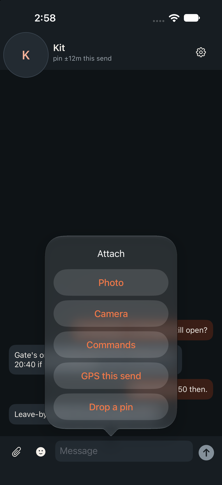
</p>
<p align="center">
  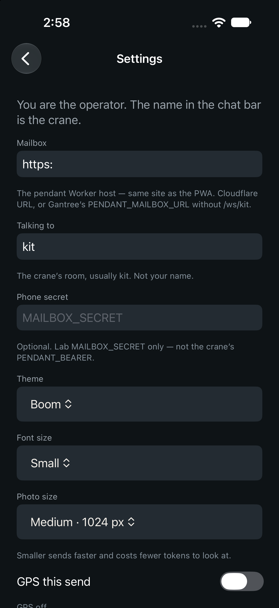
  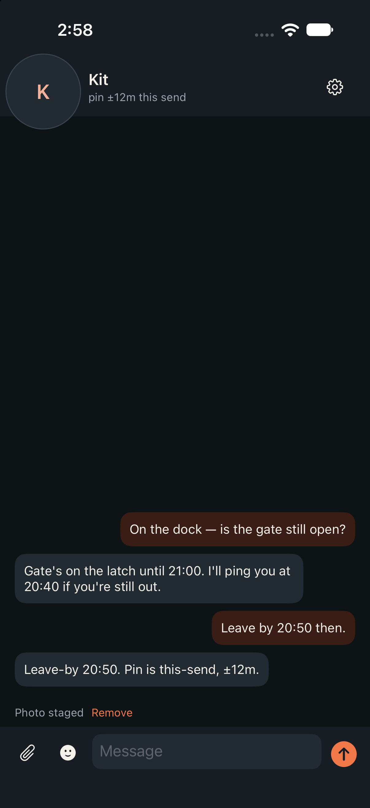
  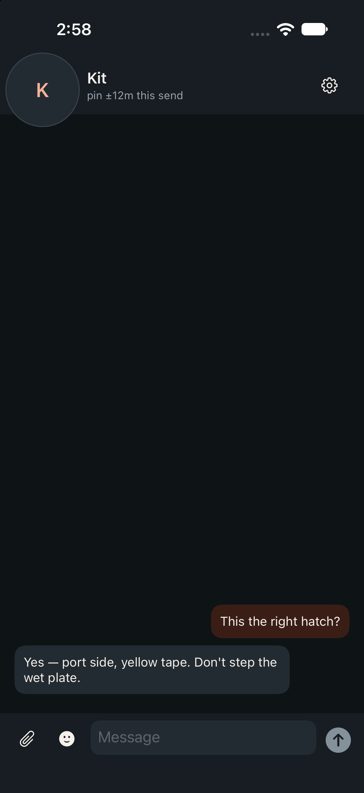
  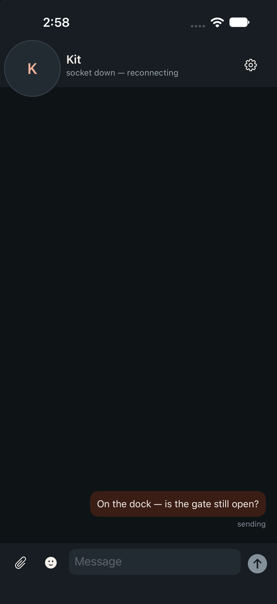
</p>

Simulator captures from `make shot`; the full list and what each
scene is: [docs/screens.md](docs/screens.md).

| Repo | Job |
| --- | --- |
| **gantree-ios** | This iOS app. Pocket thread + CarPlay message cards. |
| gantree-android | Android phone + Android Auto message cards. |
| gantree | Web app + Worker. One room per agent slug. |
| the harness | `CHANNEL=chat`. Dials **out**. |

## This is not

- A PWA / WKWebView wrapping the gantree web app. CarPlay will not project that.
- An App Store listing (sideload or TestFlight).
- A second mailbox. Forking the Worker is how you get two rooms.
- Sign in with Apple (mailbox auth change — later).
- APNs lock-screen with the process dead. Same later as gantree-android FCM.

## Talks to gantree

| Call | What |
| --- | --- |
| `GET /api/auth/config` | spike vs Google |
| `GET /api/auth/nonce` | stateless sealed nonce, 10 min; a failed GET stops sign-in |
| `POST /api/auth/token` | `{ id_token, nonce }` → `{ token, sub, email, exp }` |
| `GET /api/auth/me` | `Authorization: Bearer <jwe>` → `{ sub, email, role, agents }` (`cranes` alias until cutover) |
| `GET /ws/<slug>?role=phone` | WebSocket. Header is the JWE (Google) or the spike secret |

`POST /api/auth/token` `403` `not_allowed`: Google verified you, but you
are not on the gantree list. No session — copy your id and send it to
your gantree admin.

No cookies. Cookie CSRF is web-only. Spike walk: simulator →
`http://127.0.0.1:3000`, paste the mailbox secret. Production: copy
gantree’s **Web** client id into `HELM_GOOGLE_WEB_CLIENT_ID`, and
create a **new iOS** OAuth client (bundle `com.gantree.helm`). gantree
POSTs the token to `/api/auth/token` — Google is not given a gantree
callback.

## Hello

Xcode on a Mac opens `app/Helm.xcodeproj` (local Swift package
`Mailbox`). Linux / CI run the mailbox tests, same shape as
gantree-android:

```bash
make lint            # Apple swift-format (Docker swift:6.3.3)
make format          # rewrite Swift to match .swift-format
make test            # script tests + Mailbox swift test
make coverage        # llvm-cov + 70% bar (Mailbox)
make check-app       # test + coverage
make install-hooks   # pre-commit: tests; pre-push: coverage
make ios             # xcodebuild, unsigned (macOS)
```

Needs Swift 5.9+ for `swift test`. CI uses Swift 6.3.3 and Node 24.
The IPA needs Xcode 15+ / iOS 17.
This folder is `repos/gantree2-apps/gantree-ios`. Walk:
[docs/setup.md](docs/setup.md). Linux / this Deck (Docker `swift:6.3.3`,
no host toolchain): [docs/development.md](docs/development.md).

```bash
# on the gantree checkout
npm run dev          # 127.0.0.1:3000 — simulator reaches it as itself
```

In gantree: origin `http://127.0.0.1:3000`, slug `kit`, spike secret from
`.dev.vars`. Type. Reply in the agent tab.

Google Sign-In needs **two** OAuth clients in gantree’s GCP project:
the existing **Web** client id in `HELM_GOOGLE_WEB_CLIENT_ID` (copied
from gantree — that is the token `aud`), and a **new iOS** client
(`com.gantree.helm`). The iOS client has **no** redirect URI. gantree
never opens Safari for the token; it POSTs the ID token to the
mailbox `/api/auth/token`.

Close `4401` / handshake 401 drops the stored JWE; 403 does not.

## CarPlay

Communication notifications (`UNNotificationCategory` +
`INSendMessageIntent` + reply) are the car. Kit's reply is a message
card over maps; CarPlay reads it and takes a spoken reply. That is
the whole sideload story.

A CarPlay **app tile** needs the CarPlay messaging entitlement and
Apple's blessing. Do not expect a gantree icon in the car from a
sideload. Settings → **Test car voice** posts a check card through
the same path.

Foreground socket while gantree is open, you Connect, or you send — not
on boot. CarPlay cannot start gantree, so **open the app and send a line
before you plug in**, then lock the phone. iOS is stricter than
Android about background sockets; if you reboot, open gantree again.
APNs lock-screen (process dead, iMessage-class) is not demo / POC /
family-beta; it is if gantree becomes a public service. Design:
[docs/apns_design_and_todo.md](docs/apns_design_and_todo.md).

Open work: [docs/todo.md](docs/todo.md). Mailbox handoff:
[docs/chat_handoff.md](docs/chat_handoff.md). Phone install:
[docs/sideload_to_ios.md](docs/sideload_to_ios.md). Make the car talk:
[docs/carplay_setup.md](docs/carplay_setup.md). Deck / Docker test
walk: [docs/development.md](docs/development.md).
